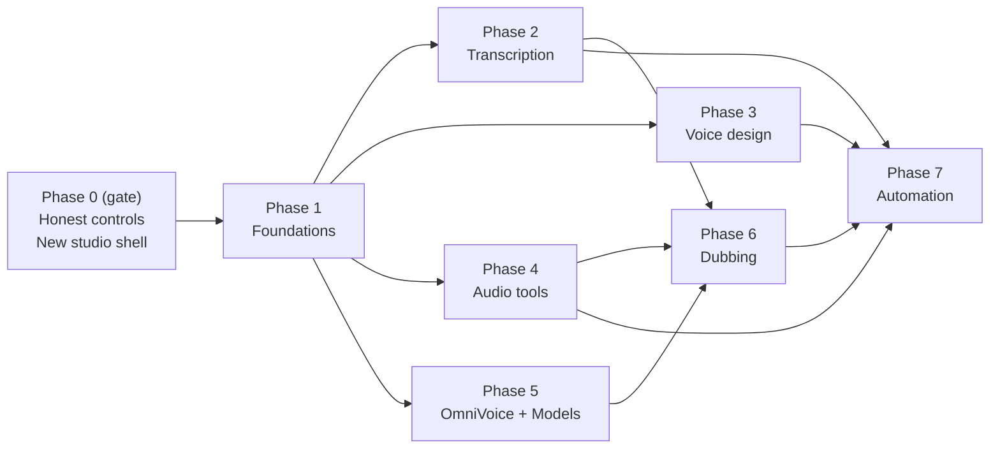

# Omnix Voice Studio — Parity & Redesign Roadmap

**Status:** Implemented, Phases 0–7 including §5 blending; real-model checks recorded per phase and in "Final re-run". (Plan revision 4, after review rounds 1–3.)
**Date:** 2026-10-19 (plan), 2026-10-20 (implementation complete)
**Primary route:** Voice Studio (`web/src/features/voice`)
**Reference project:** https://github.com/debpalash/VoiceStudio (feature reference only; not a runtime dependency)
**Shared copy:** https://claude.ai/code/artifact/8252d240-dd6f-437f-a0db-029a701520f4 (contains the rendered diagrams)

## Summary

Omnix Voice Studio reaches feature parity with [debpalash/VoiceStudio](https://github.com/debpalash/VoiceStudio) in eight phases:

| Phase | Delivers |
| --- | --- |
| 0 (gate) | Every control the studio shows works, or is disabled with a reason |
| 1 | Shared foundations: model installs, licences, secrets, GPU arbitration, script and take persistence |
| 2 | Timed, speaker-labelled transcription |
| 3 | Voice design |
| 4 | Audio tools: isolation, enhancement, watermarking |
| 5 | OmniVoice and the Models tool |
| 6 | Dubbing |
| 7 | Automation: batch, watch folders, MCP |

A redesigned studio ships alongside Phase 0 and gains a tool per phase.

**Parity means** every VoiceStudio workspace has an Omnix equivalent: cloning, voice design, dubbing, dictation, vocal isolation, diarization, batch, MCP, watermarking and model management. They run through Omnix's durable job queue, provider catalog, device permits and asset store, not a parallel stack.

**We keep what VoiceStudio lacks:**

- the audiobook production pipeline
- podcast scripting
- live streaming speech
- Live2D lip sync
- jobs stored in PostgreSQL that survive restarts

New tools reuse these through platform-tier contracts. Apps never import other apps (ADR-0016).

**Out of scope:**

- packaging and distribution: the Electron desktop shell, installers (.dmg/.exe/AppImage), Docker images and the iOS/Android companion apps (not needed for now)
- a system-wide dictation widget, because it needs a native host; in-studio push-to-talk replaces it (Phase 7)
- matching VoiceStudio's engine counts: 17 TTS engines and 10 ASR engines

We add engines by capability gap, not by count. On the TTS side we already ship Qwen3 and Fish S2 Pro, and add OmniVoice. On the ASR side we extend the NeMo stack we already run, and add WhisperX only for languages NeMo lacks.

## Where we are today

Omnix has the bones of a studio, but several visible controls do nothing, and VoiceStudio's main workspaces have no Omnix equivalent.

**Current stack**

- **UI.** One 864-line `VoiceWorkspace.tsx` holds four stacked panels: Clone a Voice, Voice Library, Jobs & Playback Queue, and Text-to-Speech (Multi-Voice) with Enhancement and Effects. Cloning and STT are also separate sidebar modules.
- **TTS.** The catalog (`src/app/providers/catalog.py`) lists `faster-qwen3-tts` and `fish-s2-pro`, both local, streaming and cloning. `select_tts_engine` sets the one global engine (`audio_provider_tts`) that every TTS caller uses. The engine runs in the TTS service under `src/services/tts`.
- **STT.**
    - The `parakeet` provider's batch `/transcribe` actually runs Nemotron (`src/services/stt/nemotron_eou_stt_server.py`). It is English-only, ignores `language`, and returns one segment covering the whole file. Live STT uses the same Nemotron service.
    - The STT environment already locks `nemo_toolkit[asr]`.
- **Jobs.** The voice feature registers four job types (`src/app/platform/voice/feature.py`):
    - `tts.synthesize` and `tts.multi_speaker_synthesize` on `gpu:tts`
    - `voice-cloning.create-profile` on `gpu:tts`
    - `voice-cloning.transcribe-sample` on `gpu:stt`

    One `tts` pool with concurrency 1 serves every `gpu:tts*` class (`composition/worker_runtime/pools.py`). Output is a single stitched WAV.
- **Audio utilities.**
    - Audiobook already has a pause policy and per-speaker loudness (`apps/audiobook/assembly.py`).
    - Audiobook already resolves ffmpeg: `OMNIX_FFMPEG`, then PATH, then the bundled imageio-ffmpeg (`apps/audiobook/export.py` `ffmpeg_binary`).
    - Audiobook already exports FLAC and MP3.

### Controls that don't work (Phase 0 inventory)

| Control | Where | What happens today | Phase 0 action |
| --- | --- | --- | --- |
| Audio effects toggles | `VoiceWorkspace.tsx:57` (`AUDIO_EFFECTS`) | Saved with the job; nothing applies them | Implement a post-stitch effects chain |
| Per-speaker style picker | `VoiceWorkspace.tsx:572,623`; `jobs.py:274` | Saved in `segment_outputs`; never reaches the engine | Wire up as `delivery_instruction` on Fish; disable on Qwen |
| Engine choice on a job | `jobs.py:345` (`get_tts_provider()` called without a name) | The job runs on whatever engine is selected when it executes, but its metadata records the requested one | Check, without switching, that the job's engine is the one loaded; fail clearly if not (§1) |
| STT workspace Transcribe | `SttWorkspace.tsx:58-60` submits `stt.transcribe` | No handler is registered, so the job is stored and never runs | Register a minimal `stt.transcribe` handler that takes an `asset_id` only (§7) |
| STT server path field | `SttWorkspace.tsx:125`, `sttJobDefaults.ts:17` (`source_path`) | Free text naming a file on the server; a handler that honoured it could read any file on the worker host | Remove it; only stored assets are accepted |
| STT language selector | `SttWorkspace.tsx:121` | The service drops `language` and is English-only | Disabled with "English only until Phase 2" |
| STT provider picker | `SttWorkspace.tsx` | One choice, which isn't the engine that actually runs | Hidden while there is only one batch engine |
| STT `save_transcript` setting and stages | `sttJobDefaults.ts` (`buildSttStages`) | Nothing runs, so it is never honoured | The handler honours it: no transcript asset when off |
| Clone "Quality" select | `VoiceWorkspace.tsx` (`registerClone('quality')`); `jobs.py:124` | Written to metadata only | Remove it, or map it to sample-cleanup strictness |
| STT `alignment` setting | `settings/effective_defaults.py:160` | Never read | Remove it until Phase 2 implements alignment |
| Footer `⌃` and `⋯` buttons, waveform | `VoiceWorkspace.tsx:586,608` | No handlers; the waveform is decorative | Replaced by the new transport bar |
| Export format (missing feature, not a broken control) | Output is WAV only | No MP3, FLAC or Opus, and no sample-rate choice | `voice.export` job |

### Gap against VoiceStudio

| Capability | VoiceStudio | Omnix today | Phase |
| --- | --- | --- | --- |
| Word timestamps, SRT/VTT, diarization | Yes (WhisperX by default) | One segment per file, English only | 2 |
| Multilingual ASR | 10 engines | English only | 2 |
| Voice design from a text prompt | Yes | No (Qwen3 VoiceDesign is vendored but not wired up) | 3 |
| Vocal isolation, enhancement | Yes | No | 4 |
| AI watermark | Yes | No | 4 |
| Model download and management | Model Manager | Reports installed or not; cannot download | 1 (install job) and 5 (UI) |
| More TTS engines | 17 | 2 (Qwen3, Fish S2 Pro) | 5 (OmniVoice) |
| Video dubbing | Yes | No | 6 |
| Batch recipes, watch folders | Yes | Durable queue, no recipes | 7 |
| Voice MCP server and local API | Yes | No inbound client model | 7 |
| Dictation | System-wide widget | Live STT only inside chat | 7 (in-studio push-to-talk) |
| Audio-quality guide | Yes | No | 0 (export presets documented) |
| Audiobook, podcast, live speech, avatar lip sync | No | Yes | Keep |

## Design upgrade

The four stacked panels become one studio. A tool rail sits on the left, the active tool's canvas in the centre, and a voice-and-output inspector on the right, with a transport bar and jobs tray along the bottom. Every later phase adds a tool to the rail instead of another panel to scroll past.

```text
+--------------------------------------------------------------------------+
| Voice Studio                                  [Engine · load state · VRAM] |
+-------------+------------------------------------------+-----------------+
| > Speak     | Script                                   | Engine          |
|   Voices    | Per line: speaker, voice, delivery,      |  Fish S2 Pro    |
|   Design    | pause, regenerate                        | Voice           |
|   Transcribe| Dave: Hello there.       Dave · Warm · ↻ |  Dave (cloned)  |
|   Dub       | Bob: How do you do?      Bob · None · ↻  | Delivery        |
|   Audio     | - - - - - {pause 600ms} - - - - - - - -  |  Stability ──●─ |
|   Tools     | Mary: I am doing fine.   Mary · None · ↻ |  Variation ─●── |
|   Batch     |                                          |  Speed     ──●─ |
|   Models    |              Ctrl+Enter  [ Generate ]    | Effects         |
|             |                                          |  (EQ)(Comp)(De-ess)
|             |                                          | Export          |
|             |                                          |  MP3·44.1k·-16LUFS
+-------------+------------------------------------------+-----------------+
| ▶  ▁▃▅▇▅▃▁▂▄▆█▆▄▂[▃▅▇▅▃ loop ▃▅▇]▅▃▁▂▄▆▆▄▂▁       A/B vs previous take |
+--------------------------------------------------------------------------+
| Jobs   active · recent · failed, with cancel and retry                   |
+--------------------------------------------------------------------------+
```

**Layout**

- **Tool rail:** Speak, Voices, Design, Transcribe, Dub, Audio Tools, Batch, Models. Tools that haven't shipped yet are hidden, not shown greyed out. Voices and Transcribe share their components with the Voice Cloning and STT modules, which keep their own sidebar entries and routes (user decision).
- **Canvas, Speak tool:** a line-based script editor (CodeMirror is already a `web` dependency). Each line uses the existing `name: text` syntax and shows its speaker, voice, an optional delivery instruction, and pause markers from the shared script grammar (Phase 0 §3). A line can be regenerated on its own (Phase 1 §5).
- **Inspector:**
    - Engine with load state and VRAM, voice picker, sampling sliders, effects and export preset.
    - A control the selected engine can't honour is disabled with a one-line reason, using the catalog capabilities and `voice_controls`.
    - The current "Style Exaggeration" slider is renamed **Variation**, so it isn't confused with delivery instructions.
- **Transport bar:** a waveform from peaks computed on the server, with play, scrub, loop region and A/B against the previous take.
- **Jobs tray:** active, recent and failed jobs, with cancel and retry. Retry needs a new route (Phase 1 §5).

**Voice library.** A card grid replaces the list. Each card shows preview, language, where the voice came from (cloned, designed, preset), which engines can use it, tags and a favourite toggle.

**Engineering**

- First do a behaviour-preserving split of `VoiceWorkspace.tsx` into `StudioShell`, `ScriptEditor`, `VoiceInspector`, `TransportBar`, `JobsTray` and `VoiceLibraryGrid`, moving the existing tests with each component. Visual changes come after.
- `VoiceStudioWorkspace.css` stays the one stylesheet, using theme-preset tokens.
- Keyboard: Ctrl+Enter generates, Space plays or pauses, Alt+Up/Down moves between lines.
- Accessibility and app-shell Playwright specs must keep passing.

## Phase 0 (gate): make every visible control honest

**Gate: no later phase starts until Phase 0 is finished.** Every row in the inventory above either works or is removed or disabled with a reason. The redesigned shell ships in this phase, without a feature flag (user decision).

1. **Pin the engine without switching.**
    - Calling `get_tts_provider(name)` isn't enough: it replaces the running engine when `name` differs (`providers/service.py:411-422`). The TTS service also switches engines for any request that names another one (`_ensure_provider`, `services/tts/tts_server.py:352`). Pinning that way would swap the GPU engine out from under live speech and audiobook renders.
    - Phase 0 adds a non-switching check, `require_loaded`:
        - In process, the job fails if the cached engine isn't the requested one.
        - Over HTTP, `QwenHttpGatewayProvider` sends `require_loaded` and the service answers 409 instead of switching.
    - The failure is non-retryable (`engine_not_loaded`), so it doesn't use up `max_attempts=3`. The job tells the user to select that engine.
    - Asset metadata records the engine that actually rendered.
    - Loading a non-selected engine for a pinned job is Phase 1 work (§6).
2. **Effects chain, one processing order.** The same order is used by render and by `voice.restitch` (Phase 1):
    1. raw segment audio
    2. speed and pitch per segment (`adjust_wav`, applied per segment as today)
    3. assembly with pauses (§3)
    4. EQ and low cut, de-esser, compressor, reverb, applied once to the assembled audio
    5. volume and a peak limiter
    6. watermark (Phase 4)
    7. store as WAV; encoding happens only at export

    - Effects are applied after assembly so reverb tails and compression stay consistent across lines. Speed and pitch stay per segment so tails and pauses aren't time-stretched.
    - Noise reduction is removed from the TTS effects list, because clean synthetic speech gains nothing from it. It moves to sample cleanup (§5).
    - Effects are stored as stable ids (`eq`, `deesser`, `compressor`, `reverb`) validated in `VoiceJobInput`. A one-time settings migration maps each saved display label to its id with the toggle set to off, so nobody's renders change silently. A notice explains that effects now apply.
    - Implemented with numpy and `soundfile` in a new `platform/voice/effects.py`.
3. **Shared script grammar.**
    - One grammar is specified with test vectors that run in both Python (`jobs.py` `_script_segments`) and TypeScript (`scriptLines.ts`):
        - `name: text` lines
        - untagged lines still become a Narrator segment, as both parsers do today
        - pause tokens in braces, `{pause 600ms}`, because Fish S2 reads square brackets as instructions
        - blank lines keep today's behaviour
    - The pause and loudness policy (`PausePolicy` in `apps/audiobook/assembly.py`) moves down to `platform/voice` and is exposed through `platform/voice/contracts.py` (ADR-0016 rule 1). Audiobook imports it from there and declares `depends_on` voice.
    - `ASSEMBLY_VERSION` (`audiobook-assembly-v3`) stays unchanged, so existing assembly hashes remain valid.
    - `_concat_wavs` then uses the policy instead of its fixed 160 ms gap, which today is also added after the last segment.
4. **Delivery instructions.**
    - A new per-speaker `delivery_instruction` field, separate from the existing `style` sampling slider. Per-line instructions come in Phase 1, once lines have identity.
    - On Fish S2 Pro it is passed as `instruct` and applied through `with_direction`.
    - Disabled on Qwen with a reason: Base cloning has no instruct, and CustomVoice only works with its built-in speakers.
    - Defaults to **None**. Today's defaults (`STYLE_OPTIONS[index]` and the stray `'Neutral'` preview value at `VoiceWorkspace.tsx:227`) are removed, so turning this on doesn't add tags to existing scripts.
    - A new `DELIVERY_INSTRUCTION` capability is added to `CAPABILITIES` and reconciled with `audio_base.AudioProviderCapability`.
5. **Clone sample cleanup.** On upload: trim silence, normalise loudness, and report clipping and estimated SNR, with a warning below a threshold. The clone Quality select either maps to how strict this check is or is removed.
6. **Export.**
    - A `voice.export` job on `cpu` converts a stored WAV asset to WAV (16/24-bit), FLAC, MP3 or Opus at a chosen sample rate and loudness preset (−16 LUFS podcast, −23 LUFS broadcast).
    - Opus accepts only 8, 12, 16, 24 or 48 kHz, so it resamples to 48 kHz by default; the UI offers only valid rates.
    - Encoding uses `soundfile` (libsndfile 1.2), with MP3 written as VBR (`bitrate_mode='VARIABLE'`), falling back to ffmpeg.
    - `ffmpeg_binary` moves from `apps/audiobook/export.py` to the kernel tier, and audiobook imports it from there. The STT service keeps its own resolver.
    - While watermarking is on (Phase 4), export refuses a source that isn't marked.
    - Loudness measurement adds `pyloudnorm` to the worker lock; today it is only in the STT lock.
    - The job is fenced with `require_execution_authority` and writes an `EXPORT` asset whose `parent_asset_ids` point at the source.
    - The presets are documented as a short audio-quality guide.
7. **STT workspace.**
    - Register an `stt.transcribe` handler that accepts only an `asset_id`. It runs today's provider and writes a transcript asset only when `save_transcript` is on.
    - Remove the free-text `source_path` field and the unused `alignment` setting.
    - Disable the language selector with a reason, and hide the one-choice provider picker.
8. **Module identity.** When Voice Cloning and STT later become studio tools, their backend module ids (`voice-cloning`, `stt`) and module states (migration `0128_module_states.sql`) are kept, so jobs, settings and module toggles keep working.

**Exit:**

- Each inventory row has a test showing the control changes output or is disabled.
- A job requested for engine A never renders on engine B.
- The grammar test vectors pass in both languages.
- MP3 and Opus exports decode at the requested sample rate.
- `stt.transcribe` completes end to end.

**Status (2026-10-19): implemented.**

- Tests: `src/tests/voice/test_voice_studio_phase0.py`, `web/src/features/voice/scriptGrammar.vectors.json` (run by both parsers), the rewritten Voice Studio, STT and Voice Cloning workspace tests, and the voice, STT and accessibility Playwright specs.
- Real-model check: Qwen3 rendered two cloned voices through the new assembly, all four effects and MP3, Opus and FLAC exports. The 800 ms pause landed where scripted, and the podcast and broadcast presets measured −16.1 and −23.0 LUFS with peaks at −1 dBFS.
- The planned check was also run on the finished code, as part of "Final re-run": the multi-speaker script on Fish with effects and delivery instructions, and a live chat call that keeps its engine while jobs pinned to Fish wait.
- Deviations from the plan text:
    - Loudness is measured by a numpy BS.1770 implementation (`platform/voice/loudness.py`) instead of adding `pyloudnorm`, because `pyloudnorm` needs scipy, which the worker lock does not have.
    - Presets reach their target through a peak limiter, not plain gain, which stopped short of the target on real speech.
    - Old effect labels from settings and older clients count as off, so no existing render changes. The settings field keeps its shape.
    - The clone Quality select now sets how strictly the sample is checked (High 20 dB, Standard 15 dB, Draft 10 dB SNR floor), which closes the open decision.
    - The STT `alignment` field stays in the settings schema, so saved documents still load. It is removed from the UI, the job defaults and the job payload.
    - The Voice Cloning sidebar module submitted `voice-cloning.train`, a job type with no handler. It now renders the shared clone panel and library, which use the working `voice-cloning.create-profile` job.
    - Alt+Up/Down keeps CodeMirror's default (move line); line navigation needs no extra binding.

## Phase 1: shared foundations

Phases 2–7 all need models installed, licences shown, secrets stored, GPU use arbitrated and studio state persisted. Building these once, first, keeps those phases from inventing their own.

1. **Model install job.**
    - `models.install` and `models.remove` run on `cpu`, using `huggingface_hub` downloads that resume after interruption and verify checksums.
    - Models go under `resources/models/<kind>`.
    - The UI at this stage is a simple list; Phase 5 builds the full Models tool.
2. **Licence registry.** A small catalog of model metadata: repository, revision, size, VRAM estimate, licence, and terms for generated output. Install refuses a gated or non-commercial model until the user accepts its terms.
3. **Hugging Face token** stored through `security/provider_secret_store.py`, not in Settings.
4. **Service conventions.** Every new model service follows the `src/services/{tts,stt,image}` precedent:
    - a `<svc>.in` plus `.lock.txt` and `.linux.lock.txt`
    - a launcher `ServiceSpec` with a fixed port (`launcher/service_manager.py`)
    - an `OMNIX_*_URL` runtime setting and a required-service policy (ADR 0012)
    - `ModelServiceMiddleware` authentication

    - Environments are conda, like the existing services, and never built inside Docker Desktop.
    - Setup scripts and lock files create the environments; the install job only fetches weights.
    - Where possible a new model joins an existing service environment instead of adding a new one.
    - This rule is new. ADR 0012 still lets a worker run local TTS in-process (`get_tts_provider` when `use_remote_tts` is false), but new models (ASR alignment, diarization, separation, enhancement, watermarking, OmniVoice) run only in services.
5. **Script and take persistence.**
    - New tables `omnix_voice_scripts`, `omnix_voice_script_lines` and `omnix_voice_takes` (workspace-scoped, `tenant_isolation` RLS) give lines a stable identity and keep every take.
    - A `voice.restitch` job rebuilds the full render from the selected takes, so regenerating one line doesn't re-render the script.
    - A job retry route is added beside `/cancel`.
    - TTS jobs also store each segment as a `voice_take` asset. That type is filtered out of the generic asset lists the Voice and STT workspaces use, so takes don't crowd them.
    - Per-line delivery instructions arrive here, now that lines have identity.
6. **GPU model swapping (target: one 24 GB RTX 4090).**
    - **Policy (user decisions).** Switching models means unloading the current one, then loading the selected one: models are swapped, not stacked. Three small helper models are the exception and may load next to the resident set when free VRAM allows:
        - batch transcription (Parakeet-TDT) and speaker detection (the diarizer)
        - the AudioSeal watermark model
        - the vocal-separation model
    - **What stays loaded.** The resident set doesn't change: the selected TTS engine, live STT (Nemotron), and any local LLM. **The local LLM is never swapped.** It has no unload path short of restarting its server, and chat holds `llm-local` permits. Jobs that need it, such as dubbing translation, wait on its own permits.
    - **What swaps.** Heavy models go through a swap in place of the selected TTS engine, which is restored afterwards: VoiceDesign, OmniVoice when it isn't the selected engine, and any future large model.
    - **This needs new enforcement.** Device permits today are only concurrency units per model class (`device_permits.py:239-246`). The residency planner (`plan_model_residency`, `create_model_residency_handlers` in `jobs/residency.py`) is exported but called nowhere. Phase 1 builds a **swap controller**:
        - **Remote TTS only.** The controller works only when TTS runs in the TTS service (`use_remote_tts`). In-process TTS mode (`providers/service.py:393-410`) has nothing for it to unload, so there swaps are disabled and pinned jobs keep failing as in Phase 0.
        - **Live-session lease.** Live speech has no durable signal today:
            - `realtime_reserved_units` is a static config number (`config/runtime.py:41-48`).
            - Permit holders exist only during a single generation call.
            - Live-call admission is per process and in memory (`platform/live_voice/capacity.py`).

          Phase 1 adds a durable, expiring lease in PostgreSQL. A live call or chat read-aloud takes it when it starts, renews it while it runs, and releases it when it ends. Non-live TTS callers must declare their `generation_class`, because `tts_priority._CURRENT` defaults to `"realtime"` (`providers/tts_priority.py:15`).
        - **Live speech interrupts a swap (user decision).**
            - A swap never starts while a live-session lease exists.
            - If a live request arrives while a swap is active, the controller stops the running group at the next segment boundary, reloads the selected engine and serves the live request.
            - The interrupted jobs go back to the queue and resume later.
            - The user hears a few seconds of load delay at the start of that call.
        - **Swap lease, not a lock.** Swaps take minutes, so they can't hold the transaction-scoped advisory lock in `PostgresDocumentStore.lock` (`persistence/document_store.py:66,352`). They are serialised by one expiring, fenced swap lease in runtime-coordination style, and every load or unload call carries the fence token.
        - **Deferred jobs.** A job that needs a model that isn't loaded doesn't hold the single `tts` pool slot while it waits. It records a swap request and is released back to the queue as deferred. The controller runs the swap, then claims queued jobs for that model in order, so they run as a group.
            - How a deferred job is represented is decided at phase start. `JobStatus` has `paused` but no deferred state.
            - A deferral must not count against `max_attempts`.
            - A long live call blocks swaps for its whole duration; this is accepted.
        - **No starvation.** A group has a maximum hold time (default 10 minutes). After that, the selected engine is restored and waiting requests are served in arrival order.
        - **Audiobook renders yield.** They pause for a pending swap request as they already do for pending permit requests (`render_service.py:415`, `other_process_priority_pending`).
        - **Durable record and recovery.** Each swap writes its intent, fence token and restore target to PostgreSQL. As built, these live in the swap tables of migration 0164 (`persistence/tts_swap.py`), not the residency document store. On startup, and whenever a swap lease expires, the gateway restores the selected engine.
        - **Service support.** The TTS service gets fenced load and unload endpoints and the Phase 0 `require_loaded` mode. It stops switching engines because a request names one; only the controller switches. Selecting an engine in the UI (`select_tts_engine`, today an in-process lock at `tts_engines.py:25,192`) also goes through the swap lease.
        - **VRAM check fails fast.** Services report used and free VRAM. A load or exempt helper that wouldn't fit in the free VRAM fails immediately with a message naming what to free (for example "unload the local LLM model or choose a smaller one"). It doesn't wait, because the resident models never leave on their own.
    - **Permit plumbing for the new `audio` class:**
        - widen the `model_class` CHECK in `0103_device_permits.sql` with a kernel migration;
        - add `audio` to both `DeviceModelClass` Literals: `config/runtime.py:15-16` (with its `_DEVICE_MODEL_CLASSES` tuple) and `device_permits.py:18`, plus the validation set (`device_permits.py:546`);
        - add `OMNIX_DEVICE_AUDIO_CAPACITY` to the capacity config;
        - add an `audio=1` pool in `pools.py` and `ResourceClass.GPU_AUDIO`, then regenerate the OpenAPI.
    - A pinned job for a non-selected engine (Phase 0 §1) now runs through the controller instead of failing, when TTS is remote.

**Exit:**

- A model installs, resumes after a killed download, and shows its licence.
- A gated model can't install without accepted terms and a token.
- Takes survive a worker restart, and `voice.restitch` reproduces the render.
- A swap never starts while a live-session lease exists.
- A live request during a swap is served on the selected engine after one reload, and the interrupted jobs resume.
- A job waiting for a swap doesn't occupy the `tts` pool slot.
- Killing the worker mid-swap restores the selected engine when the lease expires.
- A queue that alternates between two engines is grouped into at most two swaps, and no group holds longer than its cap.
- A load that doesn't fit in VRAM fails immediately with a message naming what to free.

**Status (2026-10-19): implemented.**

- Tests:
    - `src/tests/voice/test_voice_studio_phase1.py`: model installs with a fake hub, the TTS service's swap endpoints, and swap deferral in the job.
    - `src/tests/voice/test_voice_studio_phase1_postgres.py`: deferral without spending attempts; the live-session lease; the fenced swap lease and its recovery; swap requests; the controller's group, interrupt, hold-cap, VRAM fail-fast and crash-restore paths; scripts and line identity; row-level security as a non-superuser role; and the line re-render and restitch flow.
    - The retry route in `test_gateway_jobs.py`, and the Phase 1 Voice Studio web tests.
- What was built:
    - Migrations: `platform/voice/migrations/0163_voice_scripts_and_takes.sql` (row-level security on all three tables) and kernel `0164_tts_swap_coordination.sql`. The kernel migration adds the `audio` permit class and three GPU coordination tables: live sessions, swap state and swap requests. They are tenant-exempt, like the device permit tables.
    - `defer_job` returns a leased job to the queue after a delay and gives back the claim's attempt. The durable worker binds it to the job's lease. A deferred job is `queued` with a later `available_at`, so no new job status was needed.
    - The TTS service: `/api/tts/engine/swap` and `/api/tts/engine/restore` under a fence token. During a swap, non-live requests for another engine get 409 (`engine_swapped`), and live requests (the live-call stream and streamed read-aloud) interrupt the swap. `/health` reports the swap and VRAM.
    - Live calls and read-aloud streams hold a `LiveSpeechLease` for their whole duration.
    - Voice Studio renders declare `generation_class("offline")`, or `"preview"` for previews. Audiobook renders yield while a swap request is pending. Selecting an engine is refused during a swap.
    - Models: the catalog (`model_catalog.py`) with licences checked against the model cards, an admin-only install job, and the Hugging Face token stored under its own key in the protected store.
    - Takes: `render_line_ids` re-renders chosen lines, and `voice.restitch` rebuilds from selected takes. Takes are `voice_take` assets.
    - Service conventions are written up in `docs/architecture/VOICE_MODEL_SERVICES.md`.
- Real-model check (2026-10-19, an isolated stack on the scratch database (gateway with only voice and dubbing, its workers, and the TTS, STT and audio services on this code) after the live stack was stopped):
    - Qwen3 selected; a job pinned to Fish swapped Fish in (213 s, mostly the load) and rendered at 44.1 kHz.
    - A design job then swapped VoiceDesign in (two candidates in 32 s), and a Qwen3 job ran after it. The selected engine came back.
    - Peak VRAM was 18.6 GB of 24.6 GB, with no out-of-memory error.
- Fixed by the check:
    - **A pinned job failed instead of waiting while its engine loaded.** The TTS service returned 500, because the provider was empty mid-switch. It now answers 409 `engine_loading`.
    - **The VoiceDesign engine loaded the 0.6B Base weights.** The Qwen loader's `OMNIX_TTS_MODEL_DIR` override won over the checkpoint the provider named; an explicit, existing model directory now wins.
    - **Fish's ~24 GB of host memory (Windows commit) is the real limit on this host, not VRAM.**
        - Swapping Fish in with Qwen3, STT and the audio service resident ran the commit charge out. Loads paged for ten minutes, other processes failed with "the paging file is too small", and the live launcher process exited.
        - The Fish provider now refuses to start without its host memory plus 2 GB.
        - The TTS service reports host memory in `/health`, and the swap controller fails such a swap in seconds with a reason.
        - The check passed once the isolated STT and audio services were stopped for it.
- On this host, the Fish swap is the one that can freeze the machine, so the controller's fast refusal matters.
- Fixed after the follow-up review:
    - A refused restore no longer leaves the TTS service without an engine for good. The service keeps the swap open until the selected engine loads, and the controller retries the restore every 30 s. Live speech still interrupts.
    - The host-memory check credits what an unload gives back: all of Fish's process, and about 1.5 GB for VoiceDesign (measured at 1.9 GB).
    - While a restore keeps failing, jobs waiting for another engine fail with the reason instead of waiting.
    - No pinned job waits more than 30 minutes from its first swap request (`SWAP_WAIT_LIMIT_SECONDS`).
    - A blend survives the Qwen3 streaming fallback, and a blend accepts only library voice ids: a bare name would have fallen back to the default reference.
- VRAM figures for the engines are estimates: Qwen3 0.6B about 4 GB, Fish S2 Pro about 12 GB.

## Phase 2: transcription with timing and speakers

Transcribe returns word-timed, speaker-labelled transcripts that can be edited and exported as subtitles. We use the NeMo stack we already run first, and add WhisperX only for languages it can't cover.

1. **Engines.**
    - Word timestamps from NeMo Parakeet-TDT in the existing STT environment. We check the multilingual v3 checkpoint's language list at the start of the phase.
    - WhisperX is added in its own service only if dubbing needs languages Parakeet lacks.
    - Batch STT stops running through the English-only Nemotron path; live STT keeps it.
2. **Diarization.**
    - NeMo Sortformer runs in the same environment and isn't gated. However, its current checkpoint is believed to be CC-BY-NC-4.0, which must be verified at phase start. It goes through the Phase 1 licence registry and is opt-in if non-commercial. Its speaker limit (4) is shown in the UI.
    - The commercially usable default is sherpa-onnx diarization (Apache-2.0, with ONNX segmentation and embedding models), unless the licence check clears Sortformer.
    - pyannote stays optional, behind the terms and token flow. The STT environment already pins pyannote 4-era dependencies, so its version is checked at phase start.
3. **STT service load.**
    - Batch models (Parakeet-TDT and the diarizer) share the STT service process with live Nemotron.
    - They are exempt helpers (Phase 1 §6): they load next to the resident set when free VRAM allows, fail fast when it doesn't, and unload after an idle timeout.
    - Batch work runs on a lower-priority executor that yields to live requests.
    - The service reports VRAM to the swap controller (Phase 1 §6).
4. **Long files.** The whole file is diarized once; ASR runs in VAD chunks; word timings are then merged onto the speaker turns. Diarizing per chunk would break speaker identity across chunks.
5. **Contract.**
    - A versioned `TranscriptDocument`: language, duration, and segments of `{start, end, speaker, text, words[{start, end, word, confidence}]}`.
    - Saved as a `transcript` asset with `parent_asset_ids` pointing at the source audio, and generated into the OpenAPI and web clients.
    - New catalog capabilities `WORD_TIMESTAMPS` and `DIARIZATION`.
6. **Transcribe tool.** Waveform plus editable transcript; clicking a word seeks playback; speakers can be renamed; segments can be split and merged; low-confidence words are highlighted.
7. **Exports:** SRT, VTT, TXT and JSON, with at most 42 characters per line and 7 seconds per cue.
8. **Hooks.**
    - **Make a voice from Speaker 2** cuts that speaker's cleanest 10–30 seconds into a clone sample.
    - A **check render** action transcribes a TTS or audiobook render and reports word error against its script.

**Exit:**

- On a licensed two-speaker reference clip (to be chosen and checked into test resources), diarization error rate is below 15% and the median word-boundary error is below 80 ms.
- SRT output passes the subtitle linter.
- A non-English clip in a supported language transcribes with the right language code.

**Status (2026-10-19): implemented.**

- Tests:
    - `src/tests/voice/test_voice_studio_phase2.py`: chunking at quiet points, speech units, clustering (speaker count, outliers, near-identical voices, long-file sampling), a synthetic three-speaker DER, edge snapping, segment building, the service route, live-audio yielding, helper load/unload, the transcript contract and exports, the subtitle linter, the timed and render-check jobs, the transcript routes and the speaker sample.
    - Web: `transcriptDocument.spec.ts`, `RenderCheckPanel.test.tsx`, the Transcribe flow in `VoiceWorkspace.test.tsx`, the STT workspace's timed request, and an axe check of the open transcript editor.
- What was built:
    - The engine (`src/services/stt/timed_transcription.py`) runs in the STT service: `POST /transcribe/timed` on a single batch thread, plus `GET /transcribe/timed/status`. Parakeet-TDT v3 gives words and timing; long files are cut into chunks of at most 30 s at the quietest point. Word edges next to a pause are snapped to the speech energy, because TDT timing sits on an 80 ms grid.
    - Diarization deviates from §2: TitaNet speaker embeddings (CC-BY-4.0, already in the NeMo environment) and numpy average-linkage clustering, rather than sherpa-onnx, so no new dependency. Units are pause- and sentence-delimited utterances of at most 3 s. The speaker count comes from the best silhouette, and a split is accepted only when every speaker has enough units and the speaker centroids are at least 0.3 apart. Sortformer stays in the catalog, opt-in and not wired.
    - Both models are exempt helpers: they fail fast when VRAM is short and unload after 5 idle minutes. Batch work pauses between chunks while live audio frames arrive.
    - The contract: `omnix-transcript-v1` (`app/platform/voice/transcripts.py`), saved as a `transcript` asset with the source as parent. `WORD_TIMESTAMPS` and `DIARIZATION` are catalog capabilities. Edits save as numbered revisions under an expected-revision check.
    - Language is recorded as the user chose it: Parakeet v3 has no language-ID output.
    - The STT workspace now sends timed requests, so batch STT no longer uses the English-only Nemotron path. The clone-sample transcript (`tts_engines.py`) still does; it only needs English reference text.
    - Model installs download only the listed files (`allow_patterns`): the Parakeet repository also carries a safetensors copy and a GGUF.
- Real-model check (`scripts/render_transcription_reference.py`, then `scripts/check_timed_transcription.py`), on a 4090 shared with the live services:
    - Two library voices (Anaka and Sofia, the closest pair in the library at 0.80 cosine distance), 12 turns, 54 s: DER 12.7%, median word-boundary error 35 ms, WER 2.3%, and the SRT passes the linter.
    - A German clip: WER 0%, recorded as `de`, one speaker.
    - Two Qwen3 clones of the AN4 samples are nearly identical to TitaNet (centroid distance 0.14). They come out as one speaker (DER 61%), which is the intended refusal rather than a random split.
    - First model load takes about a minute (unpacking the `.nemo` archive); after that, 60 s of audio transcribes in about 10 s.
- Open: the reference clip is synthetic and not checked in, because its voices are library clones. A licensed natural two-speaker clip still needs choosing.

## Phase 3: voice design

A voice described in words becomes a saved library voice that works with every cloning engine. Design produces a reference clip, and the clip is stored like any other cloned voice.

1. **Design engine.**
    - Voice design is its own catalogued provider (`qwen3-tts-voicedesign`, using `generate_voice_design` from the vendored wrappers), not a change to the global engine.
    - It never touches `audio_provider_tts`, so audiobook, chat and queued Voice Studio jobs keep their engine.
    - The 1.7B VoiceDesign checkpoint is installed with the Phase 1 install job.
    - It runs inside the TTS service as one of the models the swap controller (Phase 1 §6) can load. A design session swaps it in place of the selected engine and restores that engine afterwards.
    - Live speech always wins: a design session doesn't start while a live-session lease exists, and a live request interrupts it (Phase 1 §6).
    - Previews in one session are grouped, so the engine isn't swapped back and forth for each candidate.
    - The automatic Fish transcript preparation is skipped on restore, because nothing in the library changed.
2. **Alternative.** If OmniVoice (Phase 5) proves to have good design quality, the Design tool can run on it instead and the separate checkpoint is dropped. That decision is made when Phase 5 starts.
3. **Design tool.**
    - A prompt with chips for age, gender, accent, pace, energy and recording quality.
    - A preview sentence and a seed.
    - **Generate 3** renders three candidates; **Vary** keeps the prompt and changes the seed.
4. **Save as voice.**
    - Renders a 15–20 second reference passage and saves it with its transcript.
    - The library entry is tagged `source: designed` and records the prompt, seed, model revision and parameters.
    - Fish S2 Pro gets its transcript without running STT.
5. **Blend (stretch).** Interpolate speaker embeddings on engines that expose them; hidden elsewhere.

**Exit:**

- A designed voice renders in Speak on both Qwen3 and Fish S2 Pro.
- A TTS job already running during a design session finishes on its original engine.
- Re-rendering from the recorded prompt, seed and revision produces a voice with speaker-embedding similarity of at least 0.85 to the saved reference. Bit-exact output isn't expected on GPU.

**Status (2026-10-19): implemented; real-model checks done.**

- Tests:
    - `src/tests/voice/test_voice_studio_phase3.py`: the engine is never listed or selectable, and a setting naming it falls back to the default; the provider loads its own checkpoint whatever `OMNIX_TTS_MODEL_DIR` says; seeds and descriptions reach the model; candidates per seed; validation; a design job asks the swap controller for the engine and waits; saving stores a designed voice with its transcript and design record.
    - `test_voice_studio_phase1_postgres.py`: a design session lingers between previews, and gives way at once when another engine is waiting.
    - Web: the Design flow (chips, Generate 3, Vary, Save as voice) and the missing-model notice.
- What was built:
    - `Qwen3VoiceDesignProvider` (`app/providers/qwen3_voice_design_provider.py`), catalogued as `qwen3-tts-voicedesign` with the new `VOICE_DESIGN` capability. It shares the Qwen model loader, so loading it unloads the base model: swap, not stack.
    - Engine selection excludes voice-design engines: the picker, `select_tts_engine` and `selected_tts_provider_id`.
    - `voice.design` renders one candidate per seed (up to three) and `voice.design.save` renders a reference passage (about 50 words, 15–20 s) in English, German, French, Spanish, Italian or Portuguese. Both pin the design engine, so the Phase 1 swap and deferral machinery loads it. Live speech still interrupts, and a TTS job already running keeps its pinned engine.
    - A designed voice goes through the clone pipeline (`execute_clone_profile`). It is tagged `source: designed` and records the description, seed, model revision (the pinned commit from the install marker) and sampling parameters. The passage is its transcript, so Fish needs no STT. A restore runs no transcript preparation: it goes straight to the service, not through `select_tts_engine`.
    - Grouping: the swap controller keeps a voice-design engine loaded for 120 s after its last job (`swap_linger_seconds`), unless another engine is waiting.
- Real-model check (2026-10-19, an isolated stack on the scratch database (gateway with only voice and dubbing, its workers, and the TTS, STT and audio services on this code) after the live stack was stopped; TitaNet speaker similarity, Parakeet-TDT WER):
    - First run (saving re-rendered the reference passage with the candidate's seed):
        - The designed voice rendered on Qwen3 (similarity 0.888 to the saved reference, WER 0%) and on Fish (0.813, WER 5.6%).
        - But the saved voice was not the candidate the person chose: similarity 0.31. The same description and seed give a different voice on other words.
    - Fix:
        - Saving clones the chosen candidate's own audio and words (`candidate_asset_id`).
        - Without a preview sentence, candidates read the language's 15–20 s reference passage, so what is saved is long enough to clone well.
        - A short custom sentence still works, but clones less faithfully: a 4 s candidate gave 0.654.
    - After the fix (a fresh run; two designed voices, each saved from its candidate, scored against it):
        - **Qwen3: voice 1 rendered 0.881, 0.822, 0.805 and 0.877 (mean 0.846); voice 2 rendered 0.894, 0.878, 0.884 and 0.885 (mean 0.885). The mean over both voices is 0.866, against the 0.85 target.** WER was 0% on all eight renders.
        - **Fish: voice 1 scored 0.861, WER 0%.** One Fish swap, run with only the TTS service and gateway up and 29.8 GB of host memory free.
        - The two voices score 0.32 against each other: the measure separates different designed voices.
- Blending (§5), built after the other phases:
    - The catalog's new `VOICE_BLEND` capability marks the engine that exposes speaker embeddings: Qwen3 (`faster-qwen3-tts`).
    - `voice.blend` names two to four library voices with weights.
        - That engine reads the reference passage from the weighted mix of their x-vectors (`speaker_blend` on the TTS request; `app/providers/speaker_blend.py`).
        - The recording is saved as an ordinary library voice (`source: blended`, with the blend recorded), so it then renders on every engine.
        - The TTS service refuses a blend on any other engine (422 `voice_blend_unsupported`).
    - The Design tool's "Blend two voices" (two voices, a mix slider, a name) appears only when an installed engine can blend.
    - Real-model check (isolated stack, Qwen3 selected, no swap), Anaka and Morgan, two unrelated voices (TitaNet similarity 0.093):
        - A 50/50 blend scored 0.224 to Anaka and 0.011 to Morgan.
        - An 80/20 blend toward Anaka scored 0.645 to Anaka and 0.027 to Morgan, so the mix steers the voice.
        - A render of each saved blend matched its reference (0.899 and 0.888).
        - A 70/30 blend saved as a library voice rendered on Qwen3 (0.900 to its reference, WER 0%) and on Fish (0.911, WER 0%): a blended voice works on the other engines too.

## Phase 4: audio tools

An Audio Tools rail entry adds isolation, enhancement and watermarking. Each runs as a job on stored assets and can be used on its own or as a step in cloning and dubbing.

1. **Vocal isolation.**
    - `audio.isolate` on `gpu:audio` uses `audio-separator` with a Mel-Band RoFormer vocal model, falling back to Demucs `htdemucs_ft`.
    - Runs in a new `audio` service that follows the Phase 1 conventions.
    - The separation model is an exempt helper (Phase 1 §6), so isolation can run during a live call when VRAM allows.
    - Writes vocal and background stem assets with `parent_asset_ids`.
    - Cloning gets an **isolate vocals first** switch.
2. **Speech enhancement.**
    - `audio.enhance` for denoising and de-reverberation of recorded samples (not TTS output).
    - DeepFilterNet3 is the candidate, but its Python package is stale, so an ONNX build or another maintained model is checked at phase start before committing.
    - Replaces the Phase 0 sample-cleanup gate when installed.
3. **Watermarking (opt-in; off by default, by user decision).**
    - When the setting is on, AudioSeal embedding is a stage inside render and `voice.restitch`, not a separate job. It runs after the effects chain and before the asset is written, so unmarked audio is never stored or downloadable.
    - AudioSeal is an exempt helper (Phase 1 §6), so embedding never swaps the TTS engine out.
    - If the audio service is unavailable while the setting is on, the render fails clearly instead of saving unmarked audio.
    - `audio.watermark-detect` checks any file.
    - Live PCM streaming isn't watermarked; this is documented.
    - Asset metadata records the watermark.
4. **Licences.** Separation checkpoints with non-commercial terms are labelled through the Phase 1 registry and stay opt-in.

**Exit:**

- On a synthetic mix of a clean voice and music, isolation improves SI-SDR by at least 10 dB.
- AudioSeal detection is at least 0.95 on marked audio after effects and after MP3 V2 and Opus export, and at most 0.05 on unmarked audio.

**Status (2026-10-19): implemented.**

- Tests:
    - `src/tests/voice/test_voice_studio_phase4.py`: stems with lineage; enhancement; detection; validation; a down service is retryable; the audio pool; cloning with isolation and enhancement; watermarking off by default; marking before writing; no unmarked asset when the service is down; design candidates carry their mark; export refuses unmarked renders; the workspace message; the service's routes and helpers; the client tells request errors from outages.
    - The audio service is in the model-service authentication and request-guard tests. Web: the Audio Tools flow, the watermark switch, and the clone switches waiting for the service.
- What was built:
    - The audio service (`src/services/audio/audio_server.py`, port 5401, `OMNIX_AUDIO_URL`) runs in its own `omnix-audio` environment from `audio.in` and `audio.lock.txt`. The launcher starts it when that environment exists.
    - Its models are exempt helpers, through the shared `services/helper_models.py` (the STT engine now uses it too).
    - `audio.isolate`, `audio.enhance` and `audio.watermark-detect` run on `gpu:audio`, with stems and cleaned recordings parented to their source. Cloning has **Isolate vocals first** and **Clean up noise** switches.
    - Enhancement deviates from §2: sherpa-onnx's GTCRN denoiser instead of DeepFilterNet3. The DeepFilterNet package is stale, and ClearerVoice pins numpy<2 and other exact versions that conflict with `audio-separator`. GTCRN works at 16 kHz. sherpa-onnx also carries DPDFNet (a DeepFilterNet model in ONNX), which is the upgrade path.
    - Watermarking: a workspace setting (`voice_watermark`, off by default; admins switch it in Audio Tools). When on, takes, renders, restitches and design candidates are marked after the effects chain and before they are written. The 16-bit message is a hash of the workspace id. If marking fails, the job fails and nothing is saved. Export refuses renders that carry no mark.
    - Not marked: live PCM streaming, voice samples and designed reference passages (inputs to cloning), and audiobook chapters (their own pipeline).
    - Model services deliver outcomes the caller acts on (a model to set up, VRAM to free, unreadable audio) as 200 envelopes, `{"ok": false, "code", "message"}`, because `ModelServiceMiddleware` replaces every error body. The STT timed route was changed the same way. See `VOICE_MODEL_SERVICES.md`.
- Real-model check (`scripts/check_audio_tools.py` in `omnix-audio`, with speech from the Phase 2 reference and a synthetic music bed at 0 dB):
    - Isolation SI-SDR gain: Mel-Band RoFormer 26.4 dB, Demucs `htdemucs_ft` 18.6 dB. A synthetic bed is easier than produced music, so expect less on real songs.
    - AudioSeal detection: 1.000 on marked audio, 1.000 after MP3 V2, 0.999 after Opus, and 0.005 on unmarked audio, with the message decoded each time.
    - Effects applied after marking lower detection to 0.86, which is why marking comes last.
    - Enhancement (smoke check; there is no exit number for it): speech with white noise at 5 dB SNR went from 9.6 to 19.0 dB SI-SDR.
- Environment notes:
    - `audio-separator` calls `ffmpeg` by name, so the service links the repository's bundled imageio-ffmpeg binary (or `OMNIX_FFMPEG`) into `resources/models/audio/bin`.
    - AudioSeal's layers `torch.compile` themselves, which needs Triton (not available on Windows), so the service sets `NO_TORCH_COMPILE`.
    - The Linux lock (`audio.linux.lock.txt`) is not generated yet: it is compiled in a Linux container, per `requirements/README.md`.

## Phase 5: OmniVoice and the Models tool

We already ship Qwen3 and Fish S2 Pro. Phase 5 adds OmniVoice, VoiceStudio's default engine, for language breadth, and turns the Phase 1 install list into a full Models tool.

1. **OmniVoice provider.**
    - Its cloning, voice-design and duration-control abilities, licence, VRAM needs and service environment are checked at phase start.
    - Its `ProviderSpec` declares only what it really supports.
    - `output_settings._SAMPLING` gets its slider mapping.
    - It runs in the TTS service if its dependencies are compatible; otherwise it gets its own service under the Phase 1 conventions.
    - Either way, the swap controller loads it in place of the selected engine.
2. **Models tool.**
    - A card per model: size, VRAM needed against the 24 GB target, licence, installed revision, and the capabilities it unlocks.
    - Install, update and remove weights, with disk usage.
    - A model whose service environment is missing shows the setup command instead of an install button.
3. **Engine picker.**
    - Grouped by task (clone, design, many languages).
    - Selecting an engine unloads the current one and loads the new one, as today, but now under the Phase 1 swap lease, so it can't race a running swap.
4. **Hardware report.** The service reports CUDA device, VRAM and free memory. Apple Silicon is future work.

**Exit:**

- OmniVoice passes the provider contract tests: synthesis, cloning if declared, slider mapping.
- Once its service environment is set up from the lock file, its weights install through the Models tool and it becomes selectable.

**Status (2026-10-19): implemented.**

- Facts checked at phase start:
    - OmniVoice (k2-fsa, 0.6B, 600+ languages, 24 kHz) clones from a reference and its words, designs from speaker attributes (`instruct`), and controls `speed` and `duration`.
    - Its code is Apache-2.0, but **its weights are CC-BY-NC-4.0** (training-data terms), so the catalog marks it non-commercial and installing needs the terms accepted.
    - It needs `transformers>=5.3`, which the Qwen TTS environment cannot take.
- Decision (Phase 3 §2): the Design tool stays on Qwen3 VoiceDesign (Apache-2.0). Non-commercial weights cannot be every workspace's design engine.
- What was built:
    - The `omnix-omnivoice` environment (`src/services/omnivoice/omnivoice.in` and `omnivoice.lock.txt`).
    - The `omnivoice` provider runs a loopback-only child server (`omnivoice_server.py`) through the new `ManagedChildServer`. Each launch gets a token the server requires. Stopping the engine ends the process and frees its VRAM, so the picker and the swap controller treat it like any engine. Fish keeps its own, older lifecycle code; moving it onto `ManagedChildServer` is a follow-up.
    - It declares synthesis, cloning, local artifacts and local device. It is a transcript engine (it clones from the sample's exact words) and takes the request's language.
    - Sliders: stability maps to `class_temperature` and style to `guidance_scale`.
    - The Models tool is its own rail entry: the GPU as the TTS service reports it; per model, VRAM against the 24 GB target, capabilities, installed revision and disk use; install, update (re-pin the revision's newest commit) and remove. A missing service environment shows its setup command instead of an install button.
    - The engine picker groups engines by task (voice cloning, expressive, many languages). Selecting an engine holds the swap lease for the whole switch, so a swap cannot start meanwhile, and a crashed switch is recovered onto the new engine.
    - `test_tts_provider_contract.py` is a shared contract every local engine passes: declared capabilities match the provider, and every slider reaches a parameter the engine reads.
- Real-model check:
    - The weights installed through the install job: 3.3 GB, pinned to `c5fdb5cc`, with the non-commercial terms accepted for this local check.
    - The provider started its child server in 11.4 s and used about 2.3 GB of VRAM; stopping it returned the VRAM.
    - An automatic voice in German and a clone of a library voice in English both transcribed back with 0% WER (Parakeet-TDT).
    - The clone's TitaNet similarity to its sample was 0.88 (0.85 with the steadiest settings), against 0.03 for an unrelated voice.
    - Renders run about 2–4 times faster than real time, including the request round trip.
- Hardware reports (§4): the TTS service's `/health` (`app/providers/gpu_report.py`) reports a CUDA device's VRAM, or on Apple Silicon (MPS) the unified memory Metal recommends for the GPU and what is free of it. The Models tool labels the latter "unified memory for the GPU". The Apple Silicon path is tested with a stand-in for torch: there is no Mac on this host.

## Phase 6: video dubbing

Dubbing is an app module (`src/app/apps/dubbing`) built on the platform voice contracts from Phases 2–5, with an LLM translation step and a review screen where a person approves every line before the final mix.

**Ownership.**

- It is an app-tier feature with its own `migrations/` folder.
- It imports only platform contracts: transcript, voice assembly, effects, export, isolation and providers.
- It doesn't import audiobook. The review-queue pattern is copied, not imported.

**Pipeline.**

- Each step is its own job type: `dub.ingest`, `dub.separate`, `dub.transcribe`, `dub.translate`, `dub.cast`, `dub.synthesize` and `dub.mux`.
- Steps advance through table-driven fan-out, following `omnix_audiobook_render_batches`.
- Any step can be re-run on its own.

1. **Ingest.** The shared `ffmpeg_binary` extracts audio from MP4, MKV, MOV or WebM.
2. **Separate.** Phase 4 isolation splits it into vocal and background stems.
3. **Transcribe.** Phase 2 produces a timed, diarized transcript of the vocal stem.
4. **Translate.**
    - The workspace's configured LLM provider translates segment by segment, with neighbouring lines as context and a time budget per segment. The plan called for a local provider (llama.cpp or LM Studio) as the default. As built, translation follows the chat setting, which can be a local model; the real-model check below used Claude Haiku through the Claude CLI.
    - A different provider can be chosen per project, with a warning that transcript text leaves the machine when it is a cloud provider.
    - A local LLM is never swapped (Phase 1 §6). Translation on one waits on its `llm-local` permits, and the 24 GB budget assumes the LLM's model fits beside the resident TTS engine.
    - Output follows a schema and is only a proposal until a person approves it.
5. **Cast.** Each source speaker is cloned from their isolated audio with a cross-lingual engine (Fish S2 Pro, Qwen3 or OmniVoice, depending on language), or mapped to a library voice.
6. **Synthesise to fit.** Each line is fitted to its budget in this order:
    1. Use the engine's duration control, if Phase 5 finds OmniVoice has one.
    2. Otherwise time-stretch within ±15%.
    3. Otherwise ask the LLM for a shorter translation, at most twice, then flag the line for review.
7. **Mix and mux.** Dubbed vocals go over the background stem with ducking and loudness normalisation, then are muxed back into the video, with target-language SRT/VTT alongside.

**Review tool.**

- A timeline with lanes for source, translation, take and background.
- Each line shows a fit badge, an editable translation, a voice override and regenerate.
- Lines are approved one at a time or in bulk.
- Final export is enabled only when every line is approved.

**Persistence.**

- New tables `omnix_dubbing_projects` and `omnix_dubbing_segments`: workspace-scoped, `tenant_isolation` RLS, a version-ordered migration with the `omnix-migration` header, and persistence tests.
- A re-run increases the segment revision, so approvals and takes stay tied to the exact translation they were made from.

**Out of scope:** lip-sync video and live dubbing.

**Exit:**

- A 3-minute, two-speaker clip dubbed English to Spanish has at least 90% of lines within ±10% of their budget on the first pass.
- Re-running one stage leaves unchanged approved lines untouched.

**Status (2026-10-19): implemented; real-model check done.**

- Tests:
    - `src/tests/dubbing/test_dubbing_module.py`: one job per step on its resource class; fitting; translation prompts, parsing and the retry; mix placement and ducking; stretch, shorten-then-flag and duration control; approved and current lines are not rendered again; the final mix waits for every approval; casting from isolated speech.
    - `test_dubbing_postgres.py`: approval only with a take of the current words; edits withdraw approval and bump the revision only for new words; **re-running translation leaves approved and hand-edited lines untouched**; re-transcription keeps lines whose words did not change; step and asset records; row-level security as a non-superuser role.
    - Web: the upload-and-start flow with the cloud-translator warning, and review (edit, speak again, approve, export enabled only when every line is approved).
- What was built:
    - `src/app/apps/dubbing`, scaffolded with `scripts/new_module.py` (it conforms). Migration `0165_dubbing_initial.sql` adds projects and lines under row-level security. Line identity is the speaker, the start time and the words. Each line carries a translation revision; a take records the revision it was rendered from; an approval records both the revision and the take.
    - Seven job types (`dub.ingest` … `dub.mux`) on the shared worker, on their resource classes. `chain` submits the next step as a follow-up up to review, and any step can run again on its own or for chosen lines. A pinned TTS engine waits for the swap controller, as Voice Studio's jobs do.
    - Translation: batches of 8 lines with 2 lines of context either side, each line's time budget given as a character budget, one JSON object back, one retry. Local providers (LM Studio, llama.cpp) take an `llm-local` device permit. The UI warns before a cloud translator.
    - Fitting (`fit.py`): within ±10% the take fits; otherwise it is stretched by at most 15%; a take still too long is shortened by the LLM at most twice, then flagged. OmniVoice renders to the budget with its duration control.
    - Mixing: takes go at their source start time over the background stem, ducked by 9 dB with 80 ms attack and 350 ms release, levelled to -16 LUFS, then muxed back into the video with the video stream copied. Target-language SRT and VTT come from the approved translations. With watermarking on, takes and the mix are marked.
    - Voice Studio's contract gained what an app builds on: transcripts, `transcribe_timed_audio`, audio tools, time-stretch, loudness, `clone_voice`, `wait_for_engine` and `watermark_render`. `ffmpeg_binary` moved to `app/runtime/ffmpeg.py`, and audiobook delegates to it.
- Fixed on the way: model services cap uploads at 50 MB (`OMNIX_MAX_UPLOAD_BYTES`).
    - Timed transcription now uploads 16 kHz mono (about 26 minutes fit).
    - The launcher gives the audio service a 1 GiB cap (`OMNIX_AUDIO_MAX_UPLOAD_BYTES`), because separation needs the full recording.
- Real-model check (2026-10-19, an isolated stack on the scratch database (gateway with only voice and dubbing, its workers, and the TTS, STT and audio services on this code) after the live stack was stopped), with translation by the default provider (Claude Haiku through the Claude CLI, as the user chose):
    - The clip: 2 min 41 s, 28 English lines in two voices, muxed into an MP4.
    - The steps (ingest → separate → transcribe → translate → cast → synthesize) ran unattended to review:
        - transcription found 30 lines and both speakers;
        - casting cloned both from their isolated speech;
        - Qwen3 rendered the Spanish.
    - First run (2026-10-19, `dub.json`, before the fitting fix): 17 of 30 takes were within ±10% before fitting. Labels: 14 fits, 4 stretched, 4 shortened, 7 short, 1 over.
    - Re-run on the finished code (2026-10-20, `dub_final.json`): **29 of 30 final takes landed within ±10% of their budget (97%, against the 90% target)**, measured from each take's length; 18 of 30 were within ±10% before fitting.
        - Labels: 18 fit, 10 stretched, 1 shortened, 1 over.
        - The one outside is a 0.3 s line ("Right." became "Sí"), at 1.86× its budget.
    - Approving all 30 lines enabled the mix: the dubbed MP4, the mix, and Spanish SRT and VTT.
    - Fixed by the check:
        - Fitting labelled lines "short" or "over" even when stretching by up to 15% put them within tolerance (the seven "short" lines of the first run), so review would have flagged them for nothing; the re-run labels them stretched.
        - The label now follows where the stretched take lands.

## Phase 7: automation and reach

Recipes, batch runs, watch folders, a voice MCP server and a local API make the studio scriptable. In-studio push-to-talk covers dictation.

1. **Recipes.** A named, versioned list of steps with settings, for example isolate → enhance → transcribe → SRT. Stored in `omnix_voice_recipes` (workspace-scoped RLS) and edited in the Batch tool.
2. **Batch runs.**
    - `omnix_voice_batch_runs` and `omnix_voice_batch_items` drive fan-out. Each item submits ordinary jobs; no parent job holds a pool slot while it waits.
    - Progress covers the whole batch, and failures are retried per item.
    - A re-run skips items whose input hash and recipe version already succeeded.
3. **Watch folders.**
    - The allowlist is operator configuration, not a user setting.
    - Paths are canonicalised; junctions, symlinks and UNC paths are rejected; writes are confined to the paired output folder.
    - One watcher holds a runtime-coordination lease, so two workers never pick up the same file. Only hosts that can see the folder take the lease.
    - Jobs created from a folder carry its configured workspace and owner.
    - The ledger is `omnix_voice_watch_items`, unique on workspace, folder, relative path and content hash.
4. **Inbound client credentials** (for both MCP and REST).
    - Today's `mcp_policy` only governs MCP servers that Omnix calls out to, so inbound clients need their own model.
    - `omnix_voice_client_credentials` holds per-client tokens bound to workspace, owner and a capability digest (precedent: `security/run_tokens.py` `caps_digest`), with RLS, expiry and revocation.
    - Only token hashes are stored. The lookup happens before the tenant is known, so it uses a narrow system-scope lookup by hash (the `0162` pattern) and then sets the tenant scope.
    - Each request sets the tenant scope and writes an audit record.
    - Profiles are ceilings, not grants: a client given `voice.speak` can't clone, design or read other workspaces.
5. **Voice MCP server and `/api/voice/v1`.**
    - MCP tools: `speak`, `transcribe`, `list_voices`, `design_voice`, `isolate`, `dub_status`.
    - A stable REST facade with a generated OpenAPI contract.
    - Both authenticate with §4 credentials.
    - **Tiers.**
        - `platform/voice` defines a tool-registry port and registers its own tools.
        - Dubbing registers `dub_status` and its steps through that port at composition, so platform never imports the dubbing app (ADR-0016).
        - The MCP endpoint and REST facade are wired in the composition layer.
6. **Push-to-talk.**
    - Hold-to-talk in the studio and chat composer, transcribing short utterances with the Phase 2 batch engine so non-English works.
    - Opening the composer keeps the batch STT model warm for a few minutes, so a short utterance doesn't wait for a cold load.
    - A system-wide widget stays out of scope until a native host exists.

**Exit:**

- A watch folder survives a worker restart with no duplicate outputs, and two workers never process the same file.
- A 50-file batch through a recipe finishes unattended.
- An MCP client without the design grant is refused `design_voice` and an audit record is written.
- A revoked token is refused.

**Status (2026-10-19): implemented; real-model checks done.**

- Tests:
    - `src/tests/voice/test_voice_studio_phase7.py`:
        - recipe chains and the job each step submits;
        - every recipe job is a registered voice job type on its resource class;
        - watch paths refuse UNC, relative, nested and junctioned folders, and delivery cannot leave the output folder;
        - MCP lists only granted tools, and a refused `design_voice` is audited;
        - the credential's tenant reaches the endpoint;
        - every facade route is a declared public path that refuses without a token.
    - `test_voice_studio_phase7_postgres.py`:
        - a credential acts in its own workspace and only within its grants;
        - **revoked, expired and altered credentials are refused, and each refusal is audited in its workspace**;
        - only admins issue credentials;
        - recipe versions change only when their steps change;
        - a batch runs each item through the steps, at most four at a time, retrying failures;
        - a failure that cannot be retried fails only its item;
        - re-runs skip inputs already done at that recipe version;
        - cancelling a run fails its pending items;
        - **one holder at a time takes a watch folder**, and **a file is taken once across watchers and restarts**;
        - outputs are written beside the input's name.
    - Web: the Batch tool (start, progress, refusing a broken chain), push-to-talk staying hidden where the browser cannot record, and the rail.
- What was built:
    - Migration `0166_voice_automation.sql` holds:
        - recipes, batch runs and items, the watch ledger and leases, and client credentials;
        - row-level security, except on the watch leases, which belong to the device.
    - Two narrow system scopes:
        - `voice.automation`: the advancer and the watcher;
        - `voice.client_credentials`: the lookup by token hash.
    - `automation.py`:
        - Recipes are versioned, and a run copies its recipe's steps.
        - The `BatchAdvancer` runs in each job-worker process and submits ordinary jobs, one step per item, at most four per run. It retries a failed step once and acts as the run's owner in the run's workspace.
        - Every item transition is a compare-and-set on the state the pass read, and each step's job is created once per item, step and attempt (`create_job_once`). Advancers in several processes never submit an item twice.
        - A new tool job, `voice.subtitles`, makes SRT, VTT or text files from a stored transcript.
    - Jobs created outside `POST /api/jobs` go through the composed handler registry (`job_submission.py`), so batch and client jobs get the same submission policy and input validation as the jobs API.
    - `watch_folders.py`:
        - Folders come from `OMNIX_VOICE_WATCH_FOLDERS`, operator configuration as JSON or a file path.
        - A path with a junction, symlink or UNC share anywhere in it is refused.
        - A file is claimed in the ledger before it is imported, once it has stopped changing.
        - Outputs go only under the paired output folder, beside the input's name, via a `.partial` file and a rename.
    - Client credentials (`client_api.py`):
        - Each credential holds a capability ceiling. An HMAC over its id, workspace, owner, capabilities and expiry is stored with it, keyed from the secret store (never PostgreSQL).
        - A credential stops working when its owner is no longer a workspace admin.
        - The signing key (`voice/client-credential-key`) is created on first use in the host's secret store (DPAPI is per Windows user).
            - Gateways on several hosts, or running as different users, need the same key: either `OMNIX_SECRET_STORE=env` with `OMNIX_SECRET_VOICE_CLIENT_CREDENTIAL_KEY` (32 characters or more), or a shared vault store.
            - With the read-only `env` store and no such variable, the client API answers 503.
        - Only the token's hash is stored, and the token is shown once.
        - Credentials expire after 90 days by default, and workspace admins issue and revoke them.
        - Every tool call is audited, refusals included, and so is every refused known token.
        - Facade routes authenticate the credential and check `Content-Length` before the body is read (`CredentialFirstRoute`). The tenant they set is the one the endpoint runs as.
        - Arguments are checked against each tool's `input_schema`. `job_status` serves only jobs the same client submitted.
    - The tool port is `VOICE_CLIENT_TOOLS` (`client_tools.py`, exported by the voice contract):
        - Voice Studio registers `speak`, `transcribe`, `list_voices` (the device's voice library, the list the studio shows), `design_voice`, `isolate` and `job_status`.
        - Dubbing registers `dub_status` through the same port, so the platform never imports the app.
        - Decision: the routes live in `platform/voice` (`automation_routes.py`), which reads the tools through the port, rather than in the composition layer. That keeps the tier rule without a second router.
    - The facade:
        - `/api/voice/v1` covers tools, audio upload, speak, transcribe, voices, design, isolate and jobs.
        - `POST /mcp/voice` is MCP over HTTP with JSON responses: initialize, ping, `tools/list` and `tools/call`.
        - Both are declared public paths. They authenticate with `Authorization: Bearer` and, like every unsafe request, need `X-Omnix-Client`.
    - Push-to-talk:
        - `POST /api/voice/dictate` transcribes with the batch engine, so any supported language works.
        - `POST /api/voice/dictate/warm` loads that engine (the STT service's `/transcribe/timed/warm`). It is called when a composer opens and again when the button is reached after the engine may have unloaded.
        - The button is in the Speak tool (each utterance becomes a script line) and in the chat composer.
    - The Batch tool covers recipes (a step that can't take what the previous one made is explained before saving), runs with per-item progress and cancel, and API clients. The rail's Dub entry now opens the Dubbing workspace.
- Real-model check (scratch database, a standalone job worker with only the voice feature, and its own audio service, so the live stack was not touched):
    - 50 eight-second clips of speech over a synthetic music bed went through isolate (RoFormer) → enhance → MP3 export.
    - All 50 finished unattended in about two minutes, worker startup included, with no failed or retried step.
    - Each item has four outputs: both stems, the cleaned voice and the MP3.
- Fixed on the way:
    - The PostgreSQL asset store dropped `parent_asset_ids` because the table has no lineage column.
    - So isolate failed when it read its stems' source, and transcripts lost their source recording (the editor's audio and speaker samples).
    - Lineage is now kept in the record's `compat` and survives descriptor updates that do not name it.
- Fixed after review:
    - **Batch runs:** concurrent advancers could submit one item twice (fixed as above). A cancelled or vanished job left its item running; a cancelled run left its jobs running; runs past the first 50 starved.
    - **Transcript saves:** a saved transcript kept its old content in PostgreSQL. The store now replaces content under the same id, refusing a stale revision atomically.
    - **Dubbing outputs:** dubbing reused asset ids, so re-runs kept stale content, SRT and VTT collided, and an approval could carry over to a re-rendered take. Every output is now a new asset.
    - **Dubbing voices:** cast voices are named with the project, so another project with the same title cannot overwrite them.
    - **Dubbing translations:** shortening never rewrites a person's words, nor a line edited while synthesis ran.
    - **Swap leases:** the swap lease is renewed while an engine loads, so another process cannot "recover" a slow load and start a second one.
    - **Push-to-talk:** releasing the button before the microphone was granted no longer starts a recording.
    - **Watch folders:**
        - The `.partial` output is created exclusively and never through a link.
        - Identical files at two paths are two inputs.
        - A claim retaken after a crash reuses the batch it started.
- Real-model checks (2026-10-19, an isolated stack on the scratch database (gateway with only voice and dubbing, its workers, and the TTS, STT and audio services on this code) after the live stack was stopped):
    - **Push-to-talk:** the warm-up loaded the batch engine. An English utterance came back in 0.59 s ("Qwen" heard as "Quinn"), and a German one, exact, in 0.11 s.
    - **A batch with transcription:** 12 recordings through isolate → transcribe → subtitles finished in 45 s, with no failure. Each item has five outputs: both stems, the transcript, SRT and VTT.

## Cross-cutting architecture

Every new tool follows the existing path: studio UI → job → feature handler → catalogued provider → model service. Results are assets; state needed for recovery lives in PostgreSQL.

**Rules every phase follows**

- **Capabilities come from the catalog.** The UI enables a control only when the provider's `ProviderSpec` declares that capability. New flags go into `CAPABILITIES` and are reconciled with `audio_base.AudioProviderCapability`. No engine names are hard-coded in components.
- **Jobs are pinned to their engine.** A job renders on the provider it names. From Phase 1 a non-loaded engine is swapped in through the swap controller; before that, or with in-process TTS, the job fails clearly.
- **Models are swapped, not stacked.** On the 24 GB target, heavy models are loaded in place of the selected engine by the swap controller (Phase 1 §6), which restores it afterwards. Live speech interrupts a swap. Only the listed small helpers and the local LLM sit beside the resident set. Global engine settings are never changed to serve one job.
- **New models run in services.** This is a new rule; ADR 0012 still allows in-worker local TTS. New models run only in services under `src/services/*`.
- **Tiers are respected (ADR-0016).** Shared audio logic (assembly, effects, export) lives in `platform/voice` and is exposed through `platform/voice/contracts.py`. The ffmpeg resolver lives in the kernel. Dubbing is an app, and apps don't import apps.
- **Results are assets with lineage** (`parent_asset_ids` and `derived_asset_ids`). Executions are fenced with `require_execution_authority`.
- **Contracts are regenerated.** Every route or payload change updates `openapi.json` and the web `generated.ts`, checked by `npm --prefix web run api:check`.
- **Tables follow conventions:**
    - `omnix_` prefix, a `workspace_id` column and a `tenant_isolation` RLS policy
    - forward migrations with the `-- omnix-migration: phase=… transactional=…` header, numbered after the latest
    - feature tables in the feature's own `migrations/` folder

**Job types**

| Job type | Resource class | Phase |
| --- | --- | --- |
| `voice.export` | `cpu` | 0 |
| `stt.transcribe` (registered in 0, upgraded in 2) | `gpu:stt` | 0, 2 |
| `models.install`, `models.remove` | `cpu` | 1 |
| `voice.restitch` | `cpu` | 1 |
| `voice.design`, `voice.design.save`, `voice.blend` | `gpu:tts` | 3 |
| `voice.subtitles` | `cpu` | 2 |
| `audio.isolate`, `audio.enhance` | `gpu:audio` (new) | 4 |
| `audio.watermark-detect` (embedding is a stage of render and restitch, not a job) | `gpu:audio` | 4 |
| `dub.ingest`, `dub.separate`, `dub.transcribe`, `dub.translate`, `dub.cast`, `dub.synthesize`, `dub.mux` | Per step | 6 |

**Tables**

| Table | Owner | Phase |
| --- | --- | --- |
| `omnix_device_capacity` and permits CHECK widened to `audio` | Kernel migration | 1 |
| `omnix_tts_swap_state`, `omnix_tts_swap_requests`, `omnix_tts_live_sessions` (swap lease and restore target, swap requests, live-speech leases; not tenant data) | Kernel migration `0164_tts_swap_coordination.sql`, `persistence/tts_swap.py` | 1 |
| `omnix_voice_scripts`, `omnix_voice_script_lines`, `omnix_voice_takes` | `platform/voice` | 1 |
| `omnix_dubbing_projects`, `omnix_dubbing_segments` | `apps/dubbing` | 6 |
| `omnix_voice_recipes`, `omnix_voice_batch_runs`, `omnix_voice_batch_items`, `omnix_voice_watch_items`, `omnix_voice_client_credentials` | `platform/voice` | 7 |

## Validation and acceptance

A phase is done when its exit criteria pass on real models and its focused checks pass after the last code change. Tests run locally; we don't wait on CI.

**Every phase runs:**

- `.venv/dev-clean/Scripts/python.exe -m pytest src/tests/voice -q --tb=short -n 0`, plus that phase's focused tests
- `ruff check` on changed Python paths, and `scripts/run_architecture_gates.py`
- `npm --prefix web run test -- <changed specs>`, `npm --prefix web run build` and `npm --prefix web run api:check`
- the accessibility and app-shell Playwright specs whenever studio UI changed
- persistence and RLS tests on the scratch PostgreSQL test database (never the live one) whenever a migration is added; migrate it first

| Phase | Automated checks | Real-model check |
| --- | --- | --- |
| 0 | Every inventory row: effect or disabled; `require_loaded` never switches engines (in-process and HTTP 409); grammar vectors in Python and TypeScript, with Narrator kept for untagged lines; export decode at the requested rate, Opus only at valid rates; `stt.transcribe` rejects anything but an `asset_id` | One multi-speaker script on Fish with effects and delivery instructions; a live chat call keeps its engine while a pinned job fails |
| 1 | Install resumes after a kill; terms gate; take persistence and restitch; swap never starts while a live-session lease exists; a live request interrupts a swap and the interrupted jobs resume; crash mid-swap restores; swap grouping; migrations idempotent | Swap between Qwen3, Fish and the VoiceDesign checkpoint on the 4090 with no out-of-memory errors |
| 2 | `TranscriptDocument` round-trip; subtitle linter; chunk merge has no duplicate words; speaker continuity across chunks | DER under 15% and boundary error under 80 ms on the reference clip; one non-English clip |
| 3 | Design never changes `audio_provider_tts`; in-flight job keeps its engine; design waits during live speech | Speaker-embedding similarity of at least 0.85 on re-render; designed voice renders on Qwen3 and Fish |
| 4 | Stem lineage; with watermarking on, no unmarked render asset is ever written and export refuses unmarked sources | SI-SDR gain of at least 10 dB; detection after MP3 and Opus at least 0.95 |
| 5 | OmniVoice provider contract tests | Install and select through the Models tool |
| 6 | Revision binds approvals; partial re-run keeps approved lines; RLS on dub tables | EN→ES clip with at least 90% of lines within ±10% |
| 7 | Watch lease exclusivity; ledger uniqueness; path canonicalisation rejects junctions and UNC paths; credential revocation; grant refusal audited | A 50-file batch finishes unattended |

**Final re-run (2026-10-20, on the finished code, live stack stopped; raw outputs saved beside the check scripts, including `phase0.log`, `swap.json`, `phase2.log`, `phase3/scores.json`, `blend_scores.json`, `phase4.log`, `phase5_render.log`, `phase5_score.log`, `engines.json`, `dub_final.json`, `batch50.json`, `batch.json` and `ptt.json`):**

| Phase | Result |
| --- | --- |
| 0 | Qwen3 rendered two voices. The 800 ms pause landed as scripted, and all four effects applied. MP3 measured −16.18 LUFS (podcast; earlier runs −16.1 and −16.03, as the renders vary) and Opus −23.0 LUFS (broadcast), per `phase0.log`; FLAC decoded at full length. The live-call and Fish check is described below the table. |
| 1 | Passed: Qwen3 → Fish → VoiceDesign → Qwen3, with the Fish job completing on a swapped-in Fish, a 18.6 GB VRAM peak and no OOM. Fish was then swapped in for three more renders (Phase 3 twice, and a blend), all completed. The two attempts that failed earlier are the host-memory findings recorded under Phase 1. Separately, when host memory is short the swap is now refused within seconds rather than paging. |
| 2 | Library-voice reference: DER 12.7%, median boundary error 35 ms, WER 2.3%, SRT lint clean. German WER 0%. |
| 3 | Saved designed voices against their candidates: Qwen3 mean 0.866 over two voices, Fish 0.861, WER 0%. An 80/20 blend moves similarity to the dominant voice from 0.22 to 0.65; a saved blend renders on Qwen3 (0.900) and Fish (0.911). |
| 4 | Isolation gains 26.4 dB (RoFormer) and 18.5 dB (Demucs; the first run measured 18.6 dB). Watermarks are detected after MP3 (1.000) and Opus (0.999); unmarked audio scores 0.005. Enhancement takes 9.6 dB to 19.0 dB. |
| 5 | OmniVoice starts in 14.5 s on about 2.3 GB of VRAM and frees it on stop. WER 0% in German and English; clone similarity 0.881 and 0.851. The gateway's engine list (`engines.json`) shows it installed and selectable under "many languages" (the render script's own probe has no settings service). |
| 6 | Re-run on the finished code (`dub_final.json`): English → Spanish, 2 min 41 s, 30 lines, both speakers. **29 of 30 final takes within ±10% of their budget** (measured from each take's length; 18 of 30 before fitting). Labels: 18 fit, 10 stretched, 1 shortened, 1 over (a 0.3 s line). All 30 approved; the dubbed MP4 and the Spanish SRT and VTT were produced. |
| 7 | Re-run on the finished code (`batch50.json`): 50 files through isolate → enhance → MP3 export, all done in 136 s, no errors, no retries. 12 recordings went through isolate → transcribe → subtitles in 45 s. Push-to-talk returned English in 0.59 s and German in 0.11 s. |

**Fish pass on the finished code** (`final_pass/result.json`, `final_pass/scores.json`). This pass reran the Phase 1 swap round trip and the Phase 3 blend together, after the last code change. Fish was loaded once and only the TTS service and gateway were running. Free host commit was 26.8 GB before Fish and fell to 3.4 GB at its lowest; nothing paged out or failed.

- **Blend:** Anaka 70 / Morgan 30 saved as a voice. Its similarity is 0.676 to Anaka and 0.057 to Morgan.
- **Swap round trip:** Qwen3 was selected. Two Fish jobs were queued together and both completed on one swapped-in Fish: the library voice at 0.799 similarity to Anaka, and the blended voice. A VoiceDesign job followed, giving 2 candidates, then a Qwen3 job. Qwen3 was restored with the fence cleared, and the VRAM peak was 19.4 GB.
- **Blended voice on each engine:** 0.886 similarity on Qwen3 and 0.897 on Fish, both with 0% WER.

**Phase 0 live call and Fish script on the finished code** (`phase0_live/result.json`, `phase0_live/renders.json`, `phase0_live/delivery.json`). This was the full Phase 0 check, run on the isolated stack with Fish loaded once.

- **Live chat call:** two spoken turns went through STT, then the chat stream (claude_cli, haiku), then the live-call websocket on Qwen3. Each answer started playing in 0.77 s and 0.72 s and lasted 29 s and 43 s. The engine was still Qwen3 after each turn.
- **Pinned jobs during the call:** two jobs pinned to Fish were queued while the call held its live-speech lease. Across six samples taken during the call, the selected engine stayed Qwen3, no swap started, and both jobs stayed queued. Since Phase 1, a pinned job waits for a live call to end instead of failing, and the engine is never taken from the call.
- **After hang-up:** Fish was swapped in once. Both jobs completed within 64 s of the hang-up, and Qwen3 was restored with the fence cleared. VRAM peaked at 18.7 GB, and free commit never fell below 7.2 GB.
- **The Fish script:** two speakers rendered on Fish, with the 800 ms pause where scripted and all four effects applied. MP3 measured −16.0 LUFS and Opus −23.0 LUFS. Each speaker's delivery instruction was sent ("whispering softly and slowly", "shouting with excitement").
- **Effect of the instructions:** against a plain take of the same script, the shouted line is 12% faster and the whispered line 4% slower. The loudness gap between them is 1.0 dB against 0.4 dB, even after compression. This is one sample, measured but not judged by ear.
- **WER:** not measured. The live stack was back by then, and with Fish loaded only 4 GB of commit was free, too little to load STT.

**Final review (2026-10-20).** A last review covered correctness and completeness. It found no broken imports or authority bypass. These issues were fixed, each with a regression test:

- **Swap requests outlived their jobs.**
    - A job cancelled while it waited, or a dubbing job (dubbing never closed its requests), kept an engine requested or "in use" for up to 15 minutes.
    - The controller now closes the requests of ended jobs on every tick, under the `voice.swap` system scope.
- **Running jobs and swaps.**
    - A swap could unload the selected engine under a TTS job still running on it. The controller now waits for TTS jobs holding a live lease to finish; this was the Phase 3 exit "a running job finishes on its original engine".
    - Audiobook renders now also wait while a swap holds the GPU, instead of failing on the swapped engine.
    - Work that is not a job (a preview, a voice save), and a job that starts just as a swap begins, could still be cut off. The TTS service now counts the generations running on its engine:
        - An engine switch (a swap, a restore, or selecting an engine) lets them finish, for at most `OMNIX_TTS_SWITCH_DRAIN_SECONDS` (default 120), before it unloads the engine.
        - New requests that are not live speech hear "engine loading" (409) meanwhile and wait.
        - Live speech is never held back: a switch it needs cuts the wait short.
- **A refused Fish start stopped another Fish server.** When Fish refused to start for lack of host memory, its cleanup stopped whatever server the shared pid file named, which could be the one another TTS service was running. The refusal now happens before anything is launched, and nothing is cleaned up.
- **OmniVoice duration control.** The generation-parameter allowlist dropped `duration`, so over the TTS service dubbing never reached OmniVoice's duration control.
- **Dubbing.**
    - Translation results overwrote a person's edit made while the LLM ran; they now apply only to lines still at the revision the step read.
    - A step that ran again after a lost lease could queue its follow-up twice; follow-ups are now created once.
- **403s.** A non-admin installing a model, or saving the hub token or the watermark setting, got a 500 instead of a 403.
- **Batch runs.**
    - A run whose owner left the workspace stayed running forever and could starve other runs. It now stops with the reason.
    - A run that fails to advance goes to the back of the queue.
- **Job retries.** A retry copied its stages' old progress, checkpoint and retry state; it now starts them afresh.

Known limit: the `audio` device-permit class exists in the schema, but nothing acquires it yet. Exempt helpers check VRAM inside their services instead.

## Sequencing, risks and open decisions

Phase 0 gates everything and Phase 1 lays the shared groundwork. After that, transcription, voice design, audio tools and OmniVoice can proceed in parallel. Dubbing joins them, and automation comes last.



Dubbing needs transcription, isolation and the language breadth OmniVoice adds. Voice design is independent of dubbing. Phase 7 needs:

- transcription and the audio tools, for recipes;
- voice design, for the MCP `design_voice` tool;
- dubbing, for `dub_status`.

**Risks**

| Risk | Effect | Mitigation |
| --- | --- | --- |
| VRAM contention on 24 GB | Out-of-memory crashes, or live speech interrupted | Swap controller: unload before load, fail-fast VRAM check, live speech interrupts a swap, grouped swaps with a hold cap |
| Swap latency (seconds per engine load) | Slow mixed-engine queues and design previews | Group queued jobs by engine; restore only after the group finishes |
| Changes to existing output (effects, delivery, grammar) | Users' renders change silently | Saved effects mapped to ids and set off; delivery defaults to None; untagged lines stay Narrator; one-time notice |
| Model licences and gating | Features we can't enable by default | Phase 1 licence registry and terms gate; Sortformer licence checked; sherpa-onnx diarization as the Apache-2.0 default |
| Each service needing its own environment | Disk use, slow setup | Join existing service environments where possible; setup scripts build environments once; the Models tool only fetches weights |
| Stale dependencies (DeepFilterNet) | Phase 4 enhancement blocked | Check alternatives at phase start |
| OmniVoice abilities not yet confirmed | Dubbing fit and Design alternative change | Check at Phase 5 start; dubbing works with time-stretch and LLM shortening anyway |
| Splitting the 864-line workspace | Regressions | Behaviour-preserving split first, tests moved with each component |

**Decisions (2026-10-19)**

| Question | Decision |
| --- | --- |
| Redesigned shell timing | Ships with Phase 0, no feature flag |
| Watermark generated speech by default | No; opt-in setting |
| Default translation provider for dubbing | Local LLM; cloud is opt-in per project |
| Voice Cloning and STT sidebar entries | Keep them as separate sidebar entries alongside the studio tools |
| GPU target and model policy | One 24 GB RTX 4090; switching unloads the current model and then loads the selected one |
| Live speech during a swap | Live speech interrupts: the swap group stops, the selected engine reloads, and the interrupted jobs resume later |
| Small helpers that may load beside the resident set | Batch transcription and diarization, AudioSeal, the vocal-separation model (each only when free VRAM allows) |
| Local LLM | Never swapped |
| Engines added | OmniVoice only; Qwen3 and Fish S2 Pro are already shipped |

**Open decisions**

- [x] Clone Quality select: maps to sample-check strictness (decided during Phase 0).
